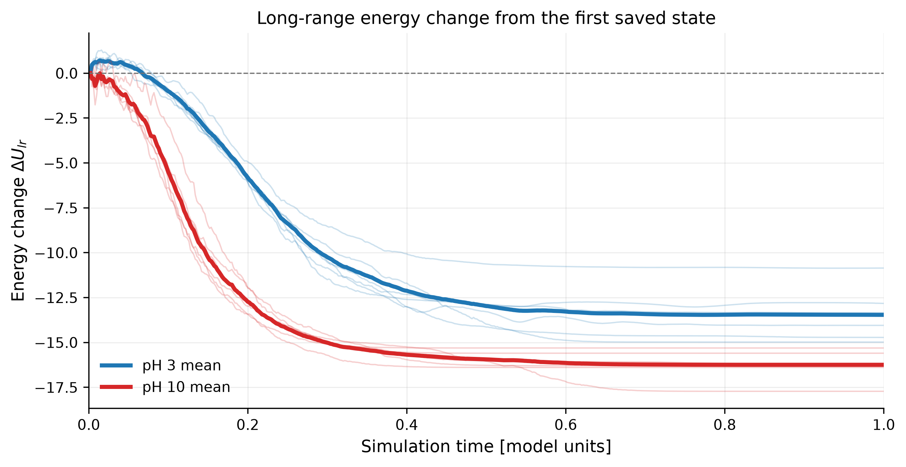
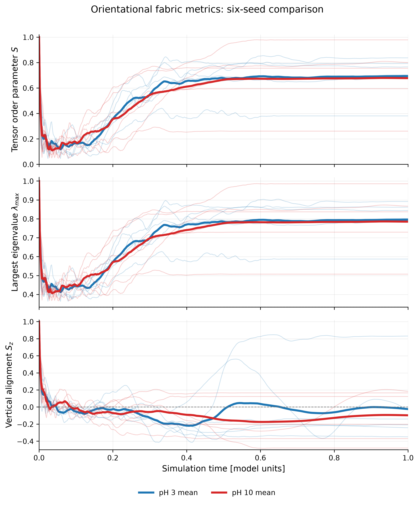
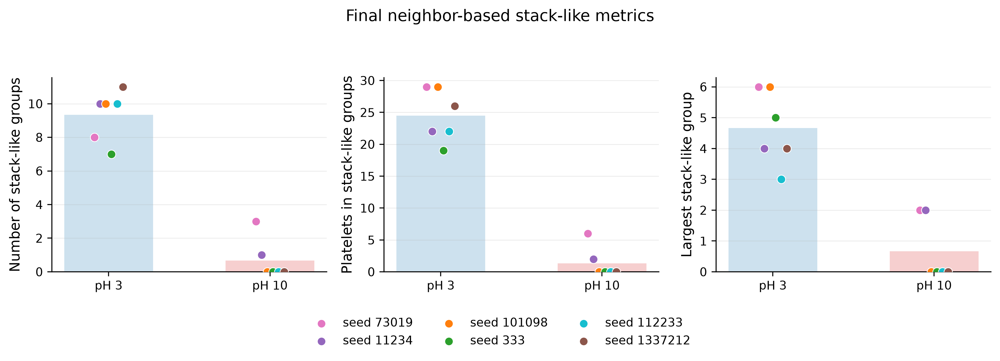

# Figure gallery

[Back to the project](../README.md) · [How the metrics are computed](METRICS.md) · [Scripts](SCRIPTS.md)

These are the saved thesis figures in [`figures/six_seed_clean/`](../figures/six_seed_clean/). They show 50-clump runs with six matched seeds (`73019`, `11234`, `101098`, `333`, `112233`, `1337212`) for each of the pH 3 and pH 10 templates, 12 runs in total. The pH labels are simplified model inputs, not a calibrated model of clay chemistry. Numbers below are copied from the committed CSV and TXT files in the same folder, and checked against them by `tests/test_docs_and_results.py`. Every figure is produced by [`plot_ph3_ph10_six_seed_clean.py`](../scripts/plot_ph3_ph10_six_seed_clean.py), which needs the raw runs that are not in this repository.

The standard deviations are sample standard deviations over the six seeds, as in `six_seed_means.txt`.

## 1. Long-range energy change

`01_energy_change_six_seeds.png`: change of the long-range energy, `delta_U_lr`, from the first saved state against simulation time (0 to 1 model units). Thin lines are single seeds, thick lines the six-seed mean. Both templates end below their starting value; the pH 10 curve drops earlier than the pH 3 curve.

| Final value, mean over six seeds (sd) | pH 3 | pH 10 |
|---|---:|---:|
| `delta_U_lr` | -13.46 (1.51) | -16.25 (0.84) |

Source: `six_seed_means.txt`, `final_values_six_seed_summary.csv`. Absolute totals differ between the templates (mean `U_lr_total` -151.141 at pH 3, 40.5063 at pH 10) because of a within-clump baseline, which is why only changes are shown; see [model limits](../README.md#model-limits). Formula: [METRICS.md section 3](METRICS.md#3-energy).

## 2. Orientation metrics

`03_orientation_metrics_six_seeds.png` (about 0.8 MB, the largest file in the repository): three stacked panels against time for the tensor order parameter `S`, its largest eigenvalue `lambda_max` and the vertical alignment `S_z`, with the same thin-per-seed, thick-mean style. The curves start at 1.0 at t = 0 (an assumed value, see [METRICS.md section 2](METRICS.md#2-orientation-metrics)). The README's reading is that overall orientation varied substantially between seeds and did not show a clear, consistent separation.

| Final value, mean over six seeds (sd) | pH 3 | pH 10 |
|---|---:|---:|
| `S` (`S_tensor`) | 0.694 (0.163) | 0.678 (0.242) |
| `lambda_max` | 0.796 (0.109) | 0.785 (0.161) |
| `S_z` | -0.023 (0.432) | -0.096 (0.292) |

Per-seed final `S` ranges from 0.381 to 0.838 at pH 3 and from 0.262 to 0.979 at pH 10 (`final_values_six_seed_summary.csv`).

## 3. Stack-like groups

`04_stacking_summary_six_seeds.png`: three panels for the final frame, showing the number of stack-like groups, the number of platelets in them and the size of the largest group. Bars are the six-seed mean, dots are individual seeds. A group is a set of connected platelets whose minimum-image centre distance is `< 0.08` and whose unoriented normals differ by at most 20 degrees. It counts nearby, similarly oriented platelets, **not confirmed face-to-face contacts**.

| Final value, mean over six seeds (sd) [range over seeds] | pH 3 | pH 10 |
|---|---:|---:|
| Stack-like groups | 9.33 (1.51) [7 to 11] | 0.67 (1.21) [0 to 3] |
| Platelets in groups | 24.5 (4.14) [19 to 29] | 1.33 (2.42) [0 to 6] |
| Largest group | 4.67 (1.21) [3 to 6] | 0.67 (1.03) [0 to 2] |

Source: `six_seed_means.txt`, `stacking_six_seed_summary.csv`. At pH 10, two of the six seeds have any group (6 and 2 platelets); the other four have none.

### Sensitivity to the grouping rule

Mean platelets in groups over six seeds, from `stacking_sensitivity_six_seed_summary.csv` (the rule used above is distance 0.08, 20 degrees):

| Distance cutoff (angle 20 degrees) | 0.06 | 0.07 | 0.08 | 0.09 | 0.10 |
|---|---:|---:|---:|---:|---:|
| pH 3 | 5 | 14.5 | 24.5 | 35.17 | 41.17 |
| pH 10 | 0 | 0 | 1.33 | 2 | 6.17 |

| Max angle (distance 0.08) | 10 degrees | 20 degrees | 30 degrees |
|---|---:|---:|---:|
| pH 3 | 19.83 | 24.5 | 26.5 |
| pH 10 | 1 | 1.33 | 1.33 |

pH 3 stays above pH 10 in every tested setting, but the size of the difference depends strongly on the distance cutoff.

### Over time

[`stacking_time_series_six_seed.csv`](../figures/six_seed_clean/stacking_time_series_six_seed.csv) holds the same count at all 501 states of each run. At t = 0 the mean is 4.33 platelets in groups for both templates (same start positions; the normals are all set to the z axis for this frame). The pH 3 mean peaks at 25.33 at time 0.677999 and ends at 24.5; the pH 10 mean never exceeds its starting 4.33 and ends at 1.33. The corresponding plot, `04_stacking_evolution_six_seeds`, is written by the script but is not committed.

## 4. Initial overlaps

No figure is committed; the table is [`initial_overlap_summary.csv`](../figures/six_seed_clean/initial_overlap_summary.csv). The driver allowed clumps to overlap at t = 0. Across the six seeds there are 6 to 9 overlapping clump pairs, and the largest pebble penetration is 9.5757e-04 (seed 101098), which is 6.0% of the pebble diameter (0.016); the smallest of the six seed maxima is 5.0%.

## Written by the script but not committed

`02_residual_kinetic_energy_log_six_seeds`, `04_stacking_evolution_six_seeds`, `05_final_values_scatter_six_seeds` (each as PNG, PDF and SVG), and the PDF and SVG versions of the three figures above. The final kinetic energy is in `six_seed_means.txt`: mean 0.00912916 (sd 0.0189734) at pH 3 and 0.000343359 (sd 0.00037394) at pH 10.

## Source-template plot

`plot_charge_templates.py` regenerates the prescribed source values against pH without any raw data; run it with `python scripts/plot_charge_templates.py --out-dir generated`. No picture of its output is committed here.
