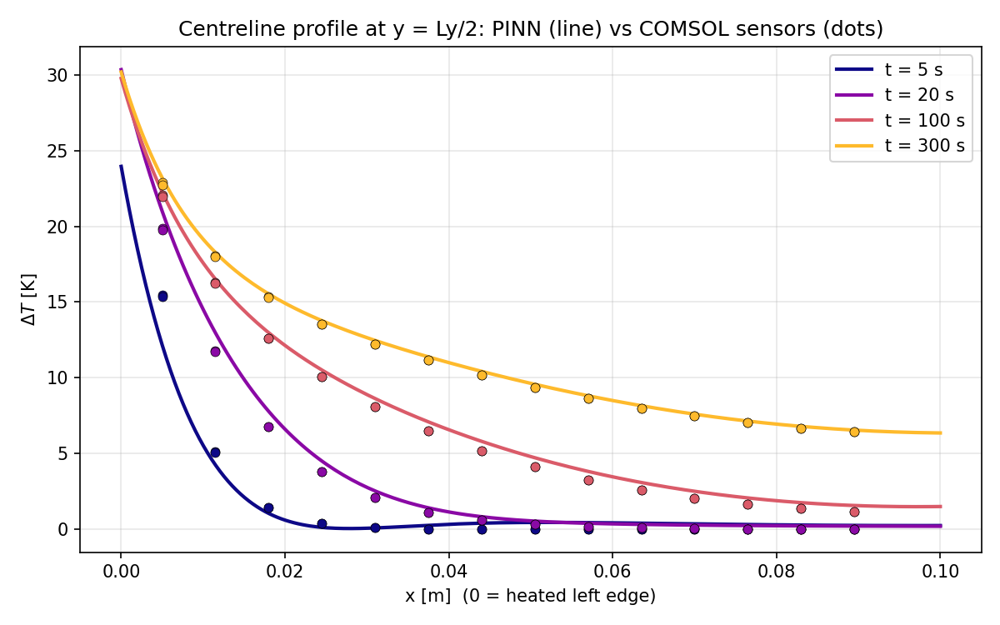

# Inverse heat transfer with a physics-informed neural network

Ivan Lisovskyi · Individual Application of Advanced Technology project · Python, PyTorch

In this project, I used temperature data to estimate how quickly heat spreads through a plate. The unknown quantity is thermal diffusivity, `alpha`. I trained a physics-informed neural network (PINN) to fit the temperatures while also following the heat equation and the plate's boundary conditions.

The model could fit temperatures closely and still give a poor estimate of diffusivity. Comparing runs with different starting values helped show why temperature error alone was not enough to judge the result.



## My work

I worked on the PINN notebook, training setup, validation and analysis. The model uses PyTorch and Fourier input features. Diffusivity is represented as `alpha = exp(log_alpha)` to keep it positive, and automatic differentiation supplies the derivatives for the heat equation and boundary conditions.

Training has two stages: first fitting the temperature field with diffusivity fixed, then training the network and diffusivity together. I checked predictions at held-out sensor locations and compared saved runs with different starting values.

The temperatures come from virtual sensors in a COMSOL simulation, not laboratory measurements. The original COMSOL model is not included.

The notebook's code now also lives in a small package, `src/pinn/`, with a command line, tests and a thin notebook. The code was moved, not redesigned: a test runs the original notebook's own cells and checks that the package gives the same loss history and trained weights. The original notebook is kept unchanged in `notebooks/final_notebook.ipynb`.

AI assistance: code scaffolding; the PINN notebook, training setup, validation and analysis by me.

## Quick start

Needs Python 3.12 or later (the pinned `numpy` requires it). From this folder:

```bash
python3 -m venv .venv && source .venv/bin/activate   # Windows: .venv\Scripts\activate
python -m pip install -r requirements-dev.txt        # pinned numpy, pandas, matplotlib, torch, jupyterlab, pytest
python -m pip install -e . --no-deps                 # makes `python -m pinn` importable
python -m pinn train --epochs 50                     # reproducibility smoke run, a few seconds on CPU
python -m pytest -q                                  # tests on exact fields and a tiny synthetic case, about 10 s
```

The smoke run reads the committed `sensors_T.csv.xz` directly and writes `history.csv`, `metrics.txt`, `checkpoint.pt` and four figures (`centerline_profile.png`, `sensor_fit.png`, `training_dashboard.png`, `contour_t300.png`) to `outputs_cli/`, which Git ignores. The command refuses to write into `results/`. `python -m pinn train` without `--epochs` runs the notebook's full schedule (2,000 + 6,000 epochs); `python -m pinn results` prints the saved-results tables below.

| Path | Contents |
|---|---|
| [`src/pinn/`](src/pinn/) | `config.py` (the notebook's constants), `model.py`, `physics.py` (heat-equation residual, boundary conditions), `train.py`, `data.py`, `plots.py`, `results.py`, `cli.py` |
| [`tests/`](tests/) | physics checks on exact solutions, a tiny synthetic training case, a package-versus-notebook equivalence check, the command line |
| [`notebooks/pinn_walkthrough.ipynb`](notebooks/pinn_walkthrough.ipynb) | thin notebook that calls the package |
| [`notebooks/final_notebook.ipynb`](notebooks/final_notebook.ipynb) | original notebook, unchanged |

## Results

The selected run's [saved metrics](results/selected-run/metrics.txt) are:

| Quantity | Result |
|---|---:|
| Estimated diffusivity | `1.085367e-5 m²/s` |
| Relative diffusivity error | `8.537%` |
| Held-out-sensor temperature RMSE | `0.395640 K` |

Across the six saved starting-value experiments, diffusivity errors range from about **12.3% to 50.5%**, even though temperature RMSE stays below 1 K. The model therefore did not recover diffusivity reliably across these runs.

This suggests that the parameter is difficult to identify in this setup, but the experiments do not isolate the cause: architecture and random sampling during training also affect the outcome. Validation uses held-out sensors from the same simulated dataset, not an independent experiment.

You can view the [sensor fit](results/selected-run/sensor_fit.png), [temperature contour](results/selected-run/contour_t300.png) and [starting-value comparison](results/selected-run/notebook_alpha_sensitivity_summary.png) without running the code. The contours clip temperature rise to `0–30 K`, so they should not be used on their own to judge full-field accuracy.

### Saved results in one table

All values below are read from files committed in this repository (`python -m pinn results` prints them); nothing here was re-run. `alpha` is in m²/s, the reference value is `1e-5`, and RMSE is on held-out sensors.

Starting-value experiments, final Fourier-feature model ([`alpha_sensitivity_summary.csv`](outputs_alpha_sensitivity/alpha_sensitivity_summary.csv), six runs):

| Start `alpha` | Recovered `alpha` | `alpha` error | RMSE (K) |
|---:|---:|---:|---:|
| 5.0e-6 | 4.954e-6 | 50.5% | 0.393 |
| 7.0e-6 | 6.485e-6 | 35.1% | 0.271 |
| 1.0e-5 | 8.542e-6 | 14.6% | 0.284 |
| 1.5e-5 | 1.123e-5 | 12.3% | 0.183 |
| 1.7e-5 | 1.199e-5 | 19.9% | 0.241 |
| 2.0e-5 | 1.311e-5 | 31.1% | 0.340 |

Network comparison ([`comparison_table.csv`](outputs_comparison/comparison_table.csv)): twelve saved runs, four starting values per variant (7e-6, 1e-5, 1.3e-5, 1.7e-5), summarised per variant:

| Variant | Mean RMSE (K) | Std of RMSE (K) | Mean `alpha` error | Best `alpha` error | Recovered `alpha` range (1e-5) |
|---|---:|---:|---:|---:|---:|
| plain MLP | 0.616 | 0.088 | 26.0% | 12.0% | 0.53 – 1.14 |
| bigger MLP | 0.613 | 0.174 | 23.8% | 3.1% | 0.56 – 1.25 |
| Fourier features | 0.433 | 0.096 | 20.1% | 2.2% | 0.63 – 1.24 |

With four runs per variant these are rough summaries. The Fourier-feature variant has the lowest mean temperature error, but the recovered `alpha` still spans roughly a factor of two for every variant. The selected run above does not appear in either table; its `history.csv` starts from `1.5e-5`, yet its numbers (8.5%, 0.396 K) differ from the 1.5e-5 row of the first table (12.3%, 0.183 K), and the saved files do not explain the difference.

These are saved project results, not a fresh training run. Exact package versions were not recorded for them, and the current notebook may not reproduce every saved value exactly.

### Reproducibility smoke run (not the study result)

`python -m pinn train --epochs 50 --device cpu` splits the 50 epochs in the notebook's 1:3 ratio (12 with diffusivity fixed, then 38 trained jointly), seed 0. On the machine I used (macOS arm64, Python 3.12.16, torch 2.15.0, CPU) it took about 5 s and printed:

| Quantity | After 50 epochs |
|---|---:|
| Estimated diffusivity | `1.488878e-5 m²/s` |
| Relative diffusivity error | `48.888%` |
| Held-out-sensor temperature RMSE | `4.204119 K` |

This only shows that the pipeline runs end to end and writes its files. The network has barely started to fit the plate and `alpha` has hardly moved from its `1.5e-5` start, so these numbers say nothing about the method; the saved results above come from the full 2,000 + 6,000 epoch schedule. Other devices give slightly different numbers (the default `--device auto` uses Apple MPS when available).

## Notebooks

Run `python prepare_data.py` once only if you want the unpacked `sensors_T.csv` (about 15.5 MB; the package and thin notebook read the compressed file directly). It uses only the standard library and will not overwrite a different CSV with that name. To check the compressed data without installing packages or writing files, run `python3 prepare_data.py --check-only`.

```bash
jupyter lab notebooks/pinn_walkthrough.ipynb
```

The thin notebook uses the package's `Config` defaults, so **its training cell runs the full 2,000 + 6,000 epochs and is not a short demo run**; lower `stage1` and `stage2` in the settings cell for a quick look. Its figures and saved-results tables come from the package.

The original notebook reads `sensors_T.csv` and writes `outputs_submission/` relative to its working directory, so it still expects to start from this folder. Because it now sits in `notebooks/`, copy it next to `prepare_data.py` first (Git ignores the copy):

```bash
python prepare_data.py && cp notebooks/final_notebook.ipynb . && jupyter lab final_notebook.ipynb
```

In Jupyter, select the new environment's Python kernel. In the original notebook, sections 1–5 define the model and helpers. **Section 6 starts training:** 2,000 epochs with fixed diffusivity, then 6,000 with trainable diffusivity.

The notebooks use Apple MPS when available and otherwise the CPU; they do not choose CUDA automatically. Set `DEVICE = "cpu"` in the original notebook's constants cell, or `Config(device="cpu")` in the thin notebook, to force CPU use.

New notebook results go to `outputs_submission/`, separate from the saved examples. See [model, data and run settings](docs/MODEL_AND_DATA.md) for the equations, validation split, configuration and output files.

## Limitations / what I would do next

- The temperatures come from COMSOL virtual sensors, and validation uses held-out sensors from the same simulation, not an independent experiment.
- Diffusivity was not recovered reliably in the saved runs (errors of 2.2% to 50.5% across the saved tables), and the experiments do not separate identifiability from architecture and sampling effects.
- The saved results were produced before the dependencies were pinned. A full 8,000-epoch run has not been repeated for this copy, so the saved numbers are not re-confirmed; what is checked is that the package reproduces the notebook's loss history and weights over a few epochs on a synthetic table, and over 30 epochs on the committed data (a one-off local comparison).
- The tests check the physics on exactly known fields, the training mechanics on a tiny synthetic table, and the output files. They do not check that training recovers `alpha`; the 50-epoch run does not.
- The contour plots clip temperature rise to `0–30 K`.
- The dataset is stored as a 5.3 MB compressed file in Git history.
- Next: compare repeated runs in a recorded environment, then test different sensor positions, heating conditions and an independent synthetic dataset. Both temperature error and diffusivity error need to be compared.

## Checks

The package, tests and 50-epoch run were checked with Python 3.12.16 on macOS arm64; the dataset and packaging helper with Python 3.12.14; the original notebook records Python 3.10.19. A GitHub Actions workflow (`.github/workflows/pinn-inverse-heat.yml`) installs the CPU build of torch and runs `python -m pytest -q` and `python -m pinn train --epochs 50 --device cpu` on Linux.

Academic references are in the [original notebook](notebooks/final_notebook.ipynb). Data provenance, publication permissions and changes made when preparing the repository are recorded in the [project notes](../docs/PROJECT_NOTES.md).
