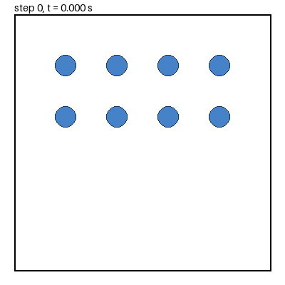

# 2D particle simulation in Python

I wrote this particle simulation for Programming in Engineering at the University of Twente. Particles move in a 2D box under gravity and push apart when they overlap. I used NumPy to store their positions and velocities, and a velocity-Verlet loop to update them over time.

This was an individual programming project, before my later work with MercuryDPM. The simulation is small enough to follow the force calculation and time-stepping loop in one file, [PIE2023.py](PIE2023.py).



*Animation produced by the project's own solver; see [How the animation was made](#how-the-animation-was-made).*

## What I implemented

- A `SimulationConfig` class to store and check the main settings.
- Contact checks between particle pairs, with equal-and-opposite forces.
- A time-stepping loop and simple reflecting boundaries.
- Text output with particle positions and velocities at regular intervals.

## Quick start

The demo needs **Python 3.11 or later**. It was checked with Python 3.12 and NumPy 2.3.5. Run these commands from this project folder:

```bash
python3 -m venv .venv
source .venv/bin/activate
python -m pip install -r requirements.txt
python demo.py
python -m unittest discover -s tests -v
```

On Windows, activate with `.venv\Scripts\activate` instead of `source ...`.

The demo runs eight particles for 100 steps and saves `outputs/demo/simulation_results.txt`. It prints progress as it runs. The runner will not overwrite an existing result, so choose another folder for a second run:

```bash
python demo.py --output outputs/second-run
```

To run the tests on their own: `python -m pytest -q` (pytest is pinned in `requirements.txt`; `python -m unittest discover -s tests -v` also works). GitHub Actions runs `python -m pip install -r requirements.txt` and `python -m pytest -q` for every change to this folder.

The demo and tests were added in September 2026; the submitted solver is unchanged. The demo starts with small, separated particles inside the box instead of the original random positions.

## How the animation was made

[demo.gif](demo.gif) is rendered from the real solver output, not drawn by hand. [make_gif.py](make_gif.py) loads the same fixture as the demo (`demo.json`: 8 particles, `k = 100`, `m = 1`, `radius = 0.04`, box `[0, 1]`, `dt = 0.001`), runs the unchanged `ParticleSimulation.velocityVerlet()` and records the particle positions at step 0 and after every 10th step. Pillow then draws each state as a 400 x 400 pixel frame (circle radius = the contact radius, 40 ms per frame, 16 colours).

Settings that differ from the demo: the GIF runs **1000 steps (t = 1.0 s, 101 frames)** instead of the demo's 100 steps, because in 100 steps (0.1 s) the particles fall only about 0.05 and barely move. Only `timesteps` is overridden (`--steps`); all other settings come from `demo.json`. Each particle is drawn as a circle of its contact radius, so a particle whose centre has been clipped to a wall overlaps the wall line (see the wall limitation below).

```bash
python -m pip install -r requirements-gif.txt   # adds Pillow 13.0.0
python make_gif.py --output demo.gif            # defaults: --steps 1000 --every 10
```

The frame-recording logic has its own tests ([tests/test_make_gif.py](tests/test_make_gif.py)); the drawing step is not tested beyond the file being produced. The committed GIF is 211,005 bytes (about 206 KB) and was generated with Python 3.12, NumPy 2.3.5 and Pillow 13.0.0; running the script again with these versions gave a byte-identical file.

## Model and implementation

Every particle has the same mass `m` and radius. When two centres are closer than `2 * radius`, their repulsive force has magnitude `k * (2 * radius - d)`, where `d` is the distance between them. The force acts in opposite directions on the two particles. Gravity adds `m * [0, -9.81]` to each particle's force.

Each step updates velocity by half a time step, moves the particles, handles the boundaries, recalculates forces and finishes the velocity update. Every pair is checked for contact, so the work grows as O(N²). The model does not include rotation, friction, damping or a faster neighbour search.

The original timestep rule is:

```text
dt = 0.01 * sqrt(m / k)
```

Use consistent units: the program does not check them. This time-step rule has not been shown to give stable results for every set of settings.

## Configuration and output

Edit a copy of `demo.json`, then run `python demo.py --config path/to/config.json --output outputs/custom-run`.

| Setting | Meaning |
| --- | --- |
| `num_particles` | Number of particles; must match the supplied positions |
| `k`, `m`, `radius` | Contact stiffness, common mass, common contact radius |
| `timesteps` | Number of integration steps; demo wrapper requires at least 5 |
| `boundary_min`, `boundary_max` | Shared lower/upper coordinate limits for both axes |
| `initial_positions` | Explicit `[x, y]` positions for the reproducible demo |
| `random_seed` | Fixes the original constructor's random initialisation before positions are replaced |

Output labels are step indices, not physical times. Each block lists positions and velocities after an update: label `s` corresponds to time `(s + 1) * dt`. The 100-step demo writes labels 0, 20, 40, 60 and 80, without saving the final state.

The original entry point uses random positions, 50 particles and 1,000 steps. Its default radius creates large overlaps, and it **overwrites `simulation_results.txt` in the current folder**. Use the demo above for a first run. To inspect the original behaviour:

```bash
python PIE2023.py
```

## Known limitations

- The original position setup does not scale correctly to other box bounds. With the default box `[0, 1]`, some particles start above the box: their y coordinates range from 0.5 to just below 1.5. A default radius of 1 also produces large overlaps.
- Walls clip particle centres to the boundary and reverse velocity components. They do not account for radius or the exact collision time.
- Particle pairs closer than `1e-6` are skipped to avoid division by zero. Two particles at exactly the same position therefore receive no separating contact force.
- The original output loop fails with fewer than five steps, misses the final state and uses the step labels described above.
- Input checks are incomplete. There has been no convergence study, energy-conservation study, experimental calibration or performance benchmark.

Six tests were added and passed on 17 September 2026; the frame-recording tests for `make_gif.py` were added in October 2026 (10 tests in total). They check invalid settings, equal-and-opposite contact forces, a free-fall step, finite demo results and output labels. These are code checks, not a validation of the physical model.

## Files

- [PIE2023.py](PIE2023.py) — original simulation code, unchanged.
- [demo.py](demo.py) and [demo.json](demo.json) — added runner and starting conditions for the small demo.
- [tests/test_simulation.py](tests/test_simulation.py) — added tests, including the short-run limitation; [tests/test_make_gif.py](tests/test_make_gif.py) tests the frame recording.
- [make_gif.py](make_gif.py) and [demo.gif](demo.gif) — added script that renders the animation from the solver, and its output.
- [requirements.txt](requirements.txt) — NumPy and pytest versions used for the checks; [requirements-gif.txt](requirements-gif.txt) adds Pillow for `make_gif.py`.
- [../.github/workflows/python-particle-simulation.yml](../.github/workflows/python-particle-simulation.yml) — CI: installs `requirements.txt` and runs `python -m pytest -q`.

See the [project notes](../docs/PROJECT_NOTES.md) for the source history and reuse permissions.

## What could be improved

The first changes would be better starting positions, correct output timestamps and walls that account for particle radius. Convergence and energy tests would then help assess the numerical results.
